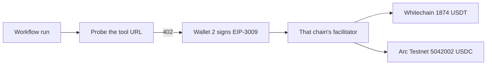

<div align="center">

# AgentMesh

### Give your AI agents a wallet. Let them pay their own way.

AgentMesh is a no-code platform for building autonomous AI agent workflows — where agents don't just think, they act. Each agent gets its own Algorand wallet and pays for the APIs it uses in real time, on-chain, without you touching a single API key.

**[→ Try AgentMesh](https://www.agent-mesh.app)**

</div>

---

## ETHGlobal Mumbai

The sections under this one describe AgentMesh as it existed before this hackathon, including an older Algorand payment design. The hackathon work is the three additions below. Repo: https://github.com/agen-mesh/wailist-agentmesh/tree/feat/whitechain-x402

**Before.** The product has been in this repo since [fdc6a104](https://github.com/agen-mesh/wailist-agentmesh/commit/fdc6a104) (2026-05-29) and is live at https://www.agent-mesh.app. About 100 to 200 people use it. A dated commit from before this weekend is [b419419b](https://github.com/agen-mesh/wailist-agentmesh/commit/b419419b) (2026-10-17, workflow schedules).

**During.** On 2026-11-06, [22550811](https://github.com/agen-mesh/wailist-agentmesh/commit/22550811) settled workflow payments in Whitechain testnet USDT. On 2026-11-07 the branch gained Arkiv workflow shares ([5aad0ba2](https://github.com/agen-mesh/wailist-agentmesh/commit/5aad0ba2)), the Arc Testnet USDC rail ([943a668c](https://github.com/agen-mesh/wailist-agentmesh/commit/943a668c)), and per-call payment on whichever of those two rails the endpoint's 402 names ([ef590e0f](https://github.com/agen-mesh/wailist-agentmesh/commit/ef590e0f)).

**Demo.** https://youtu.be/AP9LJaXOqtg

**License.** [MIT](LICENSE).

**AI.** AI coding assistants, including Grok, were used to edit the Arc rail, the dual-rail payment path, and these notes. The commits above name the people who reviewed and landed them.

### Whitechain

Chain `1874`. Settlement token USDT `0xcedfB56113143d55b2358b8CFbB0dEB5Ad2f55a7`. A workflow run pays a paid URL by signing EIP-3009 `transferWithAuthorization`. The facilitator submits that signature. Wallet 2 does not need WBT for gas.

This payment is in the main flow, 0.01 USDT, from the tool-paying wallet `0x26B70253feE141dEE4ece1E5efBe2cf70EAe26fc` to `0xDBA5141562B65De3F7D3afefE156AEC46B87f8c4`, block 12422351, status success:

https://explorer.testnet.whitechain.io/tx/0xbddeb9a9a3344b3ebe449e1108f37ce306d7c34795b6a2eed0e7b812e0675f94

An agent has to pay a URL it has no account with, inside the HTTP retry that follows a 402. A card charge or an invoice needs a merchant account and a person. Neither fits in that retry. The facilitator accepts this USDT contract and rejects a token we would mint ourselves.

Feedback: [WHITECHAIN_FEEDBACK.md](WHITECHAIN_FEEDBACK.md).

### Arc

Arc Studio project: https://studio.arc.io/app/11ddfe5a-fa3b-4239-bf10-dd8bca5c40df

The Arc notes, the console, and the payment path are in [arc/SUBMISSION.md](arc/SUBMISSION.md) and [arc/README.md](arc/README.md). Chain `5042002`, USDC `0x3600000000000000000000000000000000000000`, facilitator `https://arc.007575.xyz`. The same workflow payer signs Arc when the 402 names that network. There is no separate Arc RPC variable.



Demo video, same one as above: https://youtu.be/AP9LJaXOqtg

### Arkiv

New at this event: a signed-in user shares a workflow, and the recipient's browser reads it back from Arkiv. Write: `POST /shares` to `createEntity` in [backend/arkiv-writer/write-share.mjs](backend/arkiv-writer/write-share.mjs). Read, which the recipient sees: [frontend/src/app/s/[key]/page.tsx](frontend/src/app/s/[key]/page.tsx) calls `getEntity` in [frontend/src/lib/arkivShare.ts](frontend/src/lib/arkivShare.ts).

Testnet Rabdi, chain `7794095`. Writer of the entities below: `0x49A83B71f4EbbA4d7D645F4AdAE013BC835Cfbf7`.

Eight entities use schema `agentmesh.share.v1`. This query lists them:

```bash
curl https://rpc.rabdi.db-chain.testnet.arkiv.network/ \
  -H 'content-type: application/json' \
  --data-binary @- <<'EOF'
{"jsonrpc":"2.0","id":1,"method":"arkiv_query","params":["arkiv.schema = str('agentmesh.share.v1')",{"select":{"key":true,"creator":true,"owner":true,"expiresAt":true},"limit":"0x5"}]}
EOF
```

One entity: `0x733019e94394f8d46c312e5bcd014bbe11d5e3b94b1ea58b91a00779676cff93`

```bash
curl https://rpc.rabdi.db-chain.testnet.arkiv.network/ \
  -H 'content-type: application/json' \
  --data-binary @- <<'EOF'
{"jsonrpc":"2.0","id":1,"method":"arkiv_getEntity","params":["0x733019e94394f8d46c312e5bcd014bbe11d5e3b94b1ea58b91a00779676cff93"]}
EOF
```

Judge notes: [arkiv/schema.md](arkiv/schema.md), [arkiv/how-you-use-arkiv.md](arkiv/how-you-use-arkiv.md), [arkiv/why-arkiv.md](arkiv/why-arkiv.md), [arkiv/reach.md](arkiv/reach.md), [arkiv/friction.md](arkiv/friction.md).

### Setup and limits

Backend reads `backend/.env`. `X402_CHAIN` is `whitechain` or `arc`. Leave `FACILITATOR_URL`, `X402_RPC_URL`, and `X402_EXPLORER_URL` blank unless they match that chain. The frontend build needs `NEXT_PUBLIC_X402_CHAIN` set to the same value. Sharing also needs `ARKIV_SHARE_PRIVATE_KEY`, `ARKIV_ACCESS_KEY`, `NEXT_PUBLIC_ARKIV_SHARE_ADDRESS`, and `NEXT_PUBLIC_ARKIV_ACCESS_KEY`. Without the writer key, `POST /shares` returns `share_disabled`.

Limits: Whitechain and Arc here are testnets, and the test tokens have no monetary value. There is no public Whitechain USDT faucet. `AgentRunEscrow.sol` is not deployed and is not on the payment path. Sharing is not on `master` yet.

---

## What is this?

Most AI agent platforms make you sign up for every API your agent needs, manage credentials, and pay flat subscriptions whether the agent uses them or not.

AgentMesh flips that. Instead of API keys, agents use **money** — tiny Algorand micropayments, settled on-chain in under 5 seconds. Your agent sees a paid API, pays for it from its own wallet, and gets the data back. No accounts. No keys. No subscriptions.

You build the workflow visually. AgentMesh handles everything else.

---

## How it works

**Build** — Open the canvas. Drag out an Agent, connect some tools, add an action. Wire them together. No code required.

**Configure** — Choose your LLM (Gemini, OpenAI, Anthropic, Groq, or Mistral). Write a system prompt. For any paid API tool, just paste the URL and click **Discover** — AgentMesh reads the price and parameters automatically.

**Deploy** — Hit deploy. AgentMesh creates a real Algorand wallet for your agent. Add a small amount of ALGO to fund it.

**Run** — Your agent works autonomously. It decides which tools to call, pays for each one from its wallet, and delivers the result. Watch every step stream live in the logs.

---

## The x402 payment flow

When an agent hits a paid API:

1. The API responds with a price and an Algorand wallet address
2. The agent signs a payment transaction from its own wallet
3. The agent retries the request with the transaction ID
4. The API verifies the payment on-chain and returns the data

The whole cycle takes under 5 seconds. Algorand transaction fees are ~$0.0002, which makes per-call pricing viable even at fractions of a cent.

---

## Why Algorand

| | |
|---|---|
| **Fees** | ~$0.0002 per transaction — sub-cent API pricing actually works |
| **Speed** | ~3.5s finality — fast enough for synchronous pay-and-retry |
| **Simplicity** | No smart contracts needed — a basic payment transfer is all it takes |

---

## What's live today

| Feature | Status |
|---|---|
| Visual drag-and-drop canvas | ✅ |
| 5 LLM providers, 20+ models (Gemini, OpenAI, Anthropic, Groq, Mistral) | ✅ |
| Agentic tool-calling loop (up to 15 iterations per run) | ✅ |
| x402 paid API tool nodes with one-click discovery | ✅ |
| x402 Bazaar — browse published paid APIs, add to canvas in one click | ✅ |
| Standard HTTP tools + built-in web search | ✅ |
| ~40 action connectors (Slack, Discord, Notion, GitHub, Stripe, …) | ✅ |
| Webhook trigger — run a deployed workflow from an HTTP call | ✅ |
| Algorand wallet per agent — deploy, fund, check balance | ✅ |
| BYOK + platform-key billing, credit top-ups (INR / crypto), usage dashboard | ✅ |
| Live streaming run logs | ✅ |
| Email action node | ✅ |
| GitHub + Google OAuth, email/password auth | ✅ |
| Tendril compute — rent a machine by the hour, SSH from the console | ✅ |

---

## What's coming

- **Schedule triggers** — run agents on a timer
- **Memory nodes** — agents that remember across runs
- **Run history** — browse and replay past runs
- **Agent-to-agent calls** — deploy a workflow as an x402 endpoint, let other agents call and pay it
- **On-chain run receipts** — immutable audit trail anchored on Algorand

---

## Build your own x402 API

Want to publish a paid API that AgentMesh agents can discover and pay for? See the [`x402/`](./x402/) folder — it has the full protocol spec and a working example to fork.

---

## Contributing

See [`CONTRIBUTING.md`](./CONTRIBUTING.md) to get started — it covers local setup, the API surface, the DB schema, and the test layout.

**Hacktoberfest:** this repo is opted in. During October, merged or `hacktoberfest-accepted` PRs count toward your total. Look for issues labelled `good first issue` and `hacktoberfest`, and read the Hacktoberfest section of `CONTRIBUTING.md` first.
