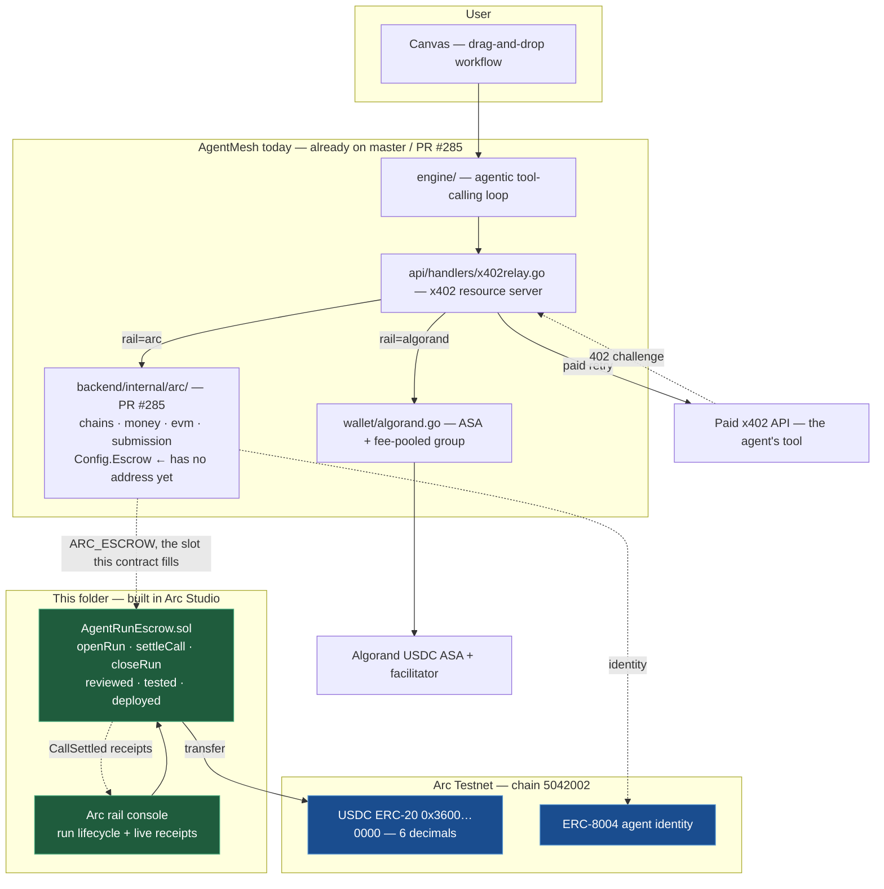

# AgentMesh on Arc

### The Arc settlement rail — USDC nanopayments for autonomous agents, with onchain run receipts.

AgentMesh is a live no-code platform for autonomous AI agent workflows. Agents call paid
APIs and settle each call over the [x402](../x402/) protocol. Until now every settlement
landed on Algorand. This folder is the **Arc rail**: the same x402 nanopayment flow,
settled in USDC on [Arc](https://docs.arc.io) — Circle's stablecoin-native L1 — plus an
escrow contract that gives every workflow run a verifiable onchain receipt.

Built with **Arc Studio** — project: https://studio.arc.io/app/11ddfe5a-fa3b-4239-bf10-dd8bca5c40df

| | |
|---|---|
| Contract | [`contracts/AgentRunEscrow.sol`](contracts/AgentRunEscrow.sol), 387 lines |
| Tests | 94 Foundry tests across 7 suites, **94 passing / 0 failing** |
| Review | Arc Studio contract review, clean after two rounds; Slither run |
| Chain | Arc Testnet, chain `5042002` |
| Fills | `ARC_ESCROW` — the `Config.Escrow` slot in `backend/internal/arc/service.go` |

---

## Why Arc changes the economics

AgentMesh's per-call payment model lives or dies on three things: the cost of a
settlement, how many assets a payer must juggle, and whether a payment can be made by
a wallet holding nothing but the asset it is spending. Arc improves all three.

| | Algorand rail (existing) | Arc rail (this folder) |
|---|---|---|
| **Assets a payer must hold** | Two — ALGO for fees *and* USDC, plus a one-time ASA opt-in before it can receive USDC at all | One — USDC **is** the native gas token |
| **Gasless payment** | A 2-transaction fee-pooled atomic group whose unsigned stub must be cosigned by a shared facilitator; group order is load-bearing and a malformed stub crashes the facilitator | Standard signed-authorization transfer; no group, no cosigner, no stub |
| **Settlement finality** | ~3.5 s | sub-second, deterministic, no reorgs |
| **Per-run accounting** | Three separate self-settlements between two platform wallets (pre-fund, platform fee, run total) | One escrow position: open once, release per call, refund the remainder |
| **Run receipt** | Reconstructed from DB rows | `CallSettled` events on Arc, one per paid API call |

The asset-count row is the one that matters most for autonomous agents. On a chain
where fees are paid in a volatile token, an agent that has spent its last cent of that
token is stranded holding USDC it cannot move. On Arc that failure mode does not exist.

---

## Architecture

### The money flow, per run

1. **Open** — the backend opens one escrow position for the run: `openRun(runId, budget, deadline)`
   pulls the run's USDC budget into `AgentRunEscrow`. The budget is metered against the
   user's existing AgentMesh credit balance, so nothing about the credit system changes.
2. **Settle** — each time the agent's tool-calling loop pays an API, the backend calls
   `settleCall(runId, payee, amount, toolRef)`. That single transaction pays the API *and*
   splits AgentMesh's platform markup to `feeRecipient`, replacing two separate Algorand
   settlements, and emits a `CallSettled` receipt.
3. **Close** — `closeRun(runId)` refunds whatever the agent did not spend. The agent side
   can always reclaim its own unspent budget after the deadline without the backend's
   cooperation — settler griefing is designed against, not trusted away.

### Why the escrow, and not just direct transfers

A direct per-call transfer works and is simpler, which is why the rail supports it. The
escrow buys three things a bare transfer cannot:

- **A hard spend ceiling per run**, enforced onchain rather than in application code. A
  runaway agent loop cannot spend past the budget its run was opened with.
- **One receipt trail per run**, queryable as events, which is the "on-chain run receipts"
  item on AgentMesh's own roadmap.
- **Atomic fee splitting**, so the platform's markup and the vendor's payment cannot
  diverge — they either both happen or neither does.

### Decimals: the one Arc footgun

USDC on Arc exposes **two interfaces over one balance**: the native representation uses
18 decimals (`msg.value`, `eth_getBalance`, gas accounting), and the ERC-20 interface at
`0x3600000000000000000000000000000000000000` uses **6** decimals, matching USDC
everywhere else. They are the same money at two scales.

Everything in this rail uses the **6-decimal ERC-20 interface only** — the contract and
console here, and the Go treasury in `backend/internal/arc/money.go`, which keeps
`ParseUSDCMicros`/`FormatUSDC` on the 6-decimal scale and exposes the 18-decimal native
balance strictly as a display conversion. `AgentRunEscrow` is deliberately not `payable` and never reads
`msg.value`, so there is no code path where the two scales can meet and silently
misprice a payment by 10¹².

---

## What this replaces

`contracts/arc/src/AgentMeshEscrow.sol` has been in the tree as an unused prototype —
64 lines, never deployed, never reviewed. Taking it through Arc Studio's contract review
surfaced why it could not be shipped as the settlement core:

| Prototype | Consequence |
|---|---|
| `release` and `refund` each accept the payer **or** the payee | No escrow guarantee. The payer can refund itself and the payee can release to itself, so either side simply takes the outcome it prefers. |
| No events | No onchain receipts — the one thing a payment audit trail needs. |
| One fixed `amount` per deal, released all at once | Cannot express per-call nanopayments drawn against a run budget. |
| No fee split | AgentMesh's platform markup cannot settle atomically with the vendor's payment. |
| No deadline, no reentrancy guard | Funds can sit unreclaimable with no unilateral path out. |

`AgentRunEscrow` is the reviewed replacement: one escrow position per workflow run, many
releases against it, fees split in the same transaction, a receipt event per call, and a
deadline after which the run owner can always recover unspent funds without the
settler's cooperation.

The backend was already written for this. `backend/internal/arc/service.go` carries a
`Config.Escrow` field read from `ARC_ESCROW` — a slot that has never had an address in
it. This contract is what goes there.

## Contract addresses used

| Contract | Address | Notes |
|---|---|---|
| USDC (ERC-20 interface) | `0x3600000000000000000000000000000000000000` | 6 decimals. Native USDC is the same balance at 18 decimals. |
| EURC | `0x89B50855Aa3bE2F677cD6303Cec089B5F319D72a` | Arc Testnet. Euro-denominated settlement. |
| Permit2 | `0x000000000022D473030F116dDEE9F6B43aC78BA3` | Signature-based funding, so a run can be funded without the payer holding gas. |
| ERC-8004 IdentityRegistry | `0x8004A818BFB912233c491871b3d84c89A494BD9e` | Onchain agent identity. |
| CCTP TokenMessengerV2 | `0x8FE6B999Dc680CcFDD5Bf7EB0974218be2542DAA` | Domain 26. Moves USDC between the Algorand and Arc rails. |

Network: chain id `5042002`, RPC `https://rpc.testnet.arc.io`, explorer
`https://explorer.testnet.arc.io`, faucet [faucet.circle.com](https://faucet.circle.com).

---

## What the review actually checked

The contract went through Arc Studio's review twice. Round one produced findings and a
fix; round two came back clean. Verified independently against the spec it was written
to, rather than taken on the review's word:

| Requirement | How it holds |
|---|---|
| Budget can never be overspent, fees included | `spent + amount + fee > budget` reverts `BudgetExceeded`. The batch path validates every item and stores the final `spent` **before** any transfer, so a late item that would breach the cap rolls back the whole batch rather than leaving earlier ones settled. |
| Settler cannot grief the run owner | `settleCall` reverts `RunExpired` once past the deadline, so the settler cannot race a reclamation. `closeRun` is reachable by the run's own agent at any time and needs no cooperation from the settler. |
| Reentrancy | `nonReentrant` on every state-changing external, state written before token calls, `SafeERC20` throughout. Tested against a token with a transfer hook and a reentrant actor. |
| A blocklisted payee cannot wedge a run | Arc reverts value transfers to blocklisted addresses. A failed payee transfer reverts that one settlement and restores `spent`; the run stays open and closable. |
| Tokens that lie | `SafeERC20` catches a silent-`false` transfer; `_checkFunding` compares the balance delta against the stated budget, so a fee-on-transfer token is rejected at funding instead of under-funding the run. Both have dedicated mocks. |
| Unbounded loops | `settleCallBatch` capped at 50 items. |
| Ownership cannot be orphaned | `Ownable2Step`, and `renounceOwnership` is explicitly disabled (`RenounceOwnershipDisabled`). |

Two hardenings the review added beyond the original spec:

- **`runId` is namespaced to its agent.** A run id must be `agent address (20 bytes) ‖
  12-byte backend tag`, enforced by `_recordRun`. Without this, anyone could open a run
  under an id the backend intended to use later and squat it.
- **`feeBps` is snapshotted per run.** Each run stores the fee rate in force when it was
  opened, so an owner changing the platform rate cannot retroactively reprice runs that
  are already open and partially settled.

### Known trade-offs, stated rather than hidden

- The run's agent can call `closeRun` at any time, not only after the deadline. For
  AgentMesh this is correct — the agent *is* the platform's own spend wallet, so it is
  withdrawing its own unspent funds. In a general third-party marketplace the same
  freedom would let a payer close ahead of a settlement for work already delivered;
  that deployment would want closure gated on the deadline.
- If the run's own agent address is blocklisted, `closeRun` reverts and the remaining
  budget stays in the contract. Unavoidable given Arc's transfer rules, and preferable
  to silently burning the refund.
