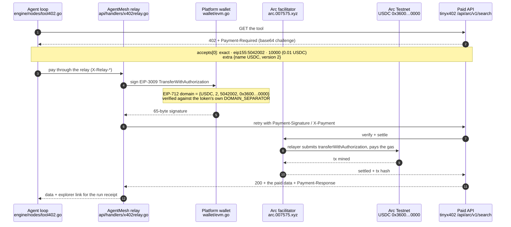
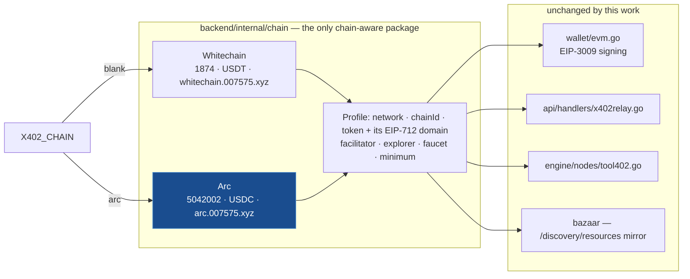

# AgentMesh on Arc

### The Arc settlement rail — USDC nanopayments for autonomous agents, through x402.

AgentMesh is a live no-code platform for autonomous AI agent workflows. Agents call paid APIs and
settle each call over the [x402](https://www.x402.org) protocol. This folder is the **Arc rail**:
the same per-call payment flow, settled in USDC on [Arc](https://docs.arc.io) — Circle's
stablecoin-native L1 — selected with one environment variable.

Built with **Arc Studio** — project: https://studio.arc.io/app/11ddfe5a-fa3b-4239-bf10-dd8bca5c40df

| | |
|---|---|
| What ships | A second chain profile in `backend/internal/chain`, plus the console in [`console/`](console/) |
| Rail | Arc Testnet (chain `5042002`), USDC `0x3600…0000`, facilitator `https://arc.007575.xyz` |
| Selected by | `X402_CHAIN=arc` — blank keeps Whitechain, AgentMesh's existing rail |
| Settled live | 2 real payments on Arc Testnet, EIP-3009, relayer-submitted (hashes below) |
| Contracts deployed | **None.** See [*The escrow, and why it is not in this path*](#the-escrow-and-why-it-is-not-in-this-path) |

---

## What actually changed

AgentMesh already settles x402 v2 `exact` payments on an EVM chain through a hosted facilitator:
the payer signs an EIP-3009 `TransferWithAuthorization` and the facilitator's relayer submits it and
pays the gas. Every chain-specific value in that path — the CAIP-2 network, the token address, its
EIP-712 domain, the facilitator URL — already funnelled through one package,
`backend/internal/chain`, which was a single `const` block pinned to Whitechain.

So bringing the rail to Arc is **a profile, not a new code path**:

- `backend/internal/chain/profile.go` — a `Profile` type, the active-profile vars every call site
  already reads, and an `init()` that selects on `X402_CHAIN`. An unrecognised value panics: this
  decides which token real money is signed away in, so a typo must not settle anything.
- `backend/internal/chain/arc.go` — the Arc profile.
- `backend/internal/chain/whitechain.go` — the same values as before, now as a `Profile`.

Nothing in the signing path, the facilitator client, the relay or the Bazaar catalog mirror needed
changing. Pointing `FACILITATOR_URL` at Arc's facilitator makes `/discovery/resources` serve Arc's
paid-endpoint catalog through the code that was already there. The rest of the diff is the three
places a Go `const` cannot hold a value chosen at startup, two error strings that named one chain,
and the Whitechain *read* connectors, which now read `chain.Whitechain` explicitly so they stay on
Whitechain whichever rail settles.

## The flow, per paid API call



The payer never holds a gas token. On Arc it could not need one anyway: USDC **is** the native gas
token, so the asset an agent spends is the asset fees are paid in.

## One package, two rails



## Why Arc changes the economics

AgentMesh's per-call payment model lives or dies on how many assets a payer must juggle, and
whether a payment can be made by a wallet holding nothing but the asset it is spending.

| | Algorand rail (retired) | Whitechain rail (current default) | Arc rail (this work) |
|---|---|---|---|
| **Assets a payer must hold** | Two — ALGO for fees *and* USDC, plus a one-time ASA opt-in before it can receive USDC at all | One in practice (the facilitator relays), but the chain's gas token is a separate volatile asset | One — USDC **is** the native gas token |
| **Can a funded payer be stranded?** | Yes — out of ALGO means the USDC cannot move | Only if it ever has to self-submit | No. The asset it spends is the asset fees are paid in |
| **Gasless payment** | 2-transaction fee-pooled group, unsigned stub cosigned by a shared facilitator, group order load-bearing | EIP-3009 authorization, relayer submits | EIP-3009 authorization, relayer submits |
| **Settlement token** | USDC (ASA) | USDT, with no public faucet — only the token owner can mint | USDC, [faucet.circle.com](https://faucet.circle.com) |
| **Receipt trail** | DB rows | `transferWithAuthorization` tx per call | `transferWithAuthorization` tx per call, on Arc's explorer |

## Decimals: the one Arc footgun

USDC on Arc exposes **two interfaces over one balance**: the native representation uses 18 decimals
(`msg.value`, `eth_getBalance`, gas accounting), and the ERC-20 interface at
`0x3600000000000000000000000000000000000000` uses **6**, matching USDC everywhere else. They are the
same money at two scales.

This rail uses the **6-decimal ERC-20 interface only**, which is also what keeps AgentMesh's
existing "USD micros" arithmetic unchanged — amounts are base units, so `10000` is 0.01 USDC. The
Arc profile carries `NativeDecimals: 18` for display and nothing prices against it. A path where
the two scales met would misprice a payment by 10¹².

## Live verification

Everything in the Arc profile was read off the chain and the facilitator on 2026-11-07, not taken
from documentation:

| Checked | How | Result |
|---|---|---|
| Chain id | `eth_chainId` at `https://rpc.testnet.arc.io` | `0x4cef52` = 5042002 |
| Token | `name()` / `version()` / `decimals()` on `0x3600…0000` | `USDC` / `2` / `6` |
| **EIP-712 domain** | `DOMAIN_SEPARATOR()` on the token vs the facilitator's `/assets` | both `0x361191522483d32a83e70ae7183b4b9629442c13a78bc9921d6f707911c8c6b0` |
| Facilitator | `GET /supported` | `exact` on `eip155:5042002` (and `eip155:5042`), `extensions: ["bazaar"]` |
| Catalog | `GET /discovery/resources` | 2 live endpoints: `…/api/arc/v1/search` GET 0.01 USDC, `…/api/arc/v1/fetch` POST 0.015 USDC |

`backend/internal/chain/profile_test.go` recomputes each profile's EIP-712 domain separator from its
own fields and asserts it equals the value the token reports, so a drifting `TokenName`,
`TokenVersion`, `ChainID` or `TokenAddress` fails the build rather than producing signatures the
facilitator silently rejects.

### Payments that actually settled

Driven from the console's own code against the live facilitator, signed by a throwaway Arc Testnet
wallet, and then confirmed independently by `eth_getTransactionReceipt`:

| Call | Transaction | Confirmed |
|---|---|---|
| `/api/arc/v1/search` | [`0xe022ec29…80cf16`](https://explorer.testnet.arc.io/tx/0xe022ec29952c7eed9ebb9611f971202a8b70af4b30f6bf5c702111934f80cf16) | status `0x1`, block 71102859, submitted by the facilitator's relayer `0x79DD…2d85` to the USDC contract, `AuthorizationUsed` + `Transfer` logs |
| `/api/arc/v1/fetch` | [`0xffef67af…ccc185`](https://explorer.testnet.arc.io/tx/0xffef67af800ecd426cad9015d6119716cf7c6abac4816e7bb2dca2dd7bccc185) | status `0x1`, block 71102864, same shape |

A wallet with no USDC gets the facilitator's real rejection
(`invalid_exact_evm_insufficient_balance`), surfaced in the console rather than swallowed.

## Run the demo

**The console** — the Arc rail walked one paid call at a time: the decoded 402 challenge, the typed
data signed, the settlement, the receipt.

- In Arc Studio, with no setup: open the
  [project](https://studio.arc.io/app/11ddfe5a-fa3b-4239-bf10-dd8bca5c40df) and use the preview panel.
- Locally:
  ```bash
  cd arc/console
  npm install
  npm run dev        # http://localhost:5173
  ```
  Connect an injected wallet on Arc Testnet and fund it with USDC from
  [faucet.circle.com](https://faucet.circle.com). Nothing else is needed — no key, no API key, no
  env file. Neither the facilitator nor the paid-tool host sends CORS headers, so the browser
  reaches both through the dev-server proxies in `console/vite.config.ts` (`/fac`, `/tool`); the
  console must be run through `vite`, not served as static files.

**AgentMesh itself on the Arc rail** — the same payment, inside the product:

```bash
# backend/.env
X402_CHAIN=arc
# leave FACILITATOR_URL, X402_RPC_URL, X402_EXPLORER_URL blank: the profile has them
```

Both platform wallets need Arc Testnet USDC (`faucet.circle.com`) and nothing else. Start the
backend and the startup line reads:

```
x402 on Arc Testnet (eip155:5042002): asset USDC 0x3600000000000000000000000000000000000000; Wallet 1 0x…, Wallet 2 0x…
x402 facilitator supports exact on eip155:5042002
```

Set `NEXT_PUBLIC_X402_CHAIN=arc` for the frontend so its copy, the settlement token label and the
demo workflow's paid endpoint match the rail the backend is paying on. The "Run demo workflow"
button then builds a workflow against Arc's `…/api/arc/v1/search` — tinyx402's endpoints are per
chain now, and each quotes only its own asset.

## Backend wiring

| Piece | Where | Note |
|---|---|---|
| Rail selection | `backend/internal/chain/profile.go` | `X402_CHAIN`; `chain.Active` is the chosen profile, the package vars mirror it |
| EIP-3009 signing | `backend/internal/wallet/evm.go` → `SignAuthorization` | builds the domain from `chain.TokenName/TokenVersion/ChainID`; refuses to sign for any asset but the active profile's token |
| Startup network check | `backend/cmd/server/main.go` → `walletSvc.ValidateNetwork` | the RPC's chain id must equal the profile's, so a mismatched `X402_RPC_URL` fails loudly instead of signing for the wrong chain |
| Facilitator | `backend/internal/x402/facilitator.go` | `/supported` is probed at startup; `503 signer_balance_low` means the relayer is out of gas, not a bad payment |
| Paying a tool | `backend/internal/engine/nodes/tool402.go`, `walletpay.go` | reads the challenge from the `Payment-Required` header (base64) as well as the body, and sends both `Payment-Signature` (base64, the v2 spec name) and `X-Payment` (raw JSON, the older dialect) — which is why tinyx402's Arc endpoints needed no client change |
| Tool catalog | `backend/internal/bazaar/catalog.go` | mirrors `FACILITATOR_URL/discovery/resources`, keeping only `chain.Network`, so on Arc the Bazaar is Arc's endpoints |
| Whitechain read connectors | `backend/internal/engine/nodes/connectors_whitechain.go` | pinned to `chain.Whitechain` on purpose — they read Whitechain state whatever rail settles |

## The escrow, and why it is not in this path

[`contracts/AgentRunEscrow.sol`](contracts/AgentRunEscrow.sol) is a per-run USDC escrow for Arc —
`openRun` / `settleCall` / `settleCallBatch` / `closeRun`, a snapshotted platform fee, agent-
namespaced run ids, a `CallSettled` receipt per call. It was written and reviewed in Arc Studio over
two rounds with 7 Foundry suites (94 tests, **Arc Studio's run, not reproduced here** — this machine
has no Foundry) and Slither.

It is **deployed on Arc Testnet but not wired into anything.** The rail above needs no contract:
x402 `exact` settles against USDC's own EIP-3009 interface. The deployment was verified directly
against `rpc.testnet.arc.io`:

| | |
|---|---|
| Address | [`0xb6F60f98aA3b36FbFf1f061d2f9C069Bd5Cb5748`](https://explorer.testnet.arc.io/address/0xb6F60f98aA3b36FbFf1f061d2f9C069Bd5Cb5748) — 7,108 bytes of code |
| Deploy | `0x04e8ef64…85bd4`, block 71064852, succeeded |
| Exercised | `openRun 0x8c1a2510…b5b2e5` → `settleCall 0xd9104d3d…71aec0` → `closeRun 0x81a708dd…e970a4b`, all succeeded |
| `settleCall` receipt | 0.02 USDC to the payee and 0.0002 (1% at the deployed 100 bps) to the fee recipient, plus one `CallSettled` log with 2 indexed and 4 data words — matching `CallSettled(bytes32,address,uint256,uint256,bytes32,uint256)` |

That it runs on chain does not make it part of this submission's path; nothing in the rail calls it. The escrow buys things that bare per-call transfers
cannot — an onchain spend ceiling per run, a queryable receipt trail, atomic fee splitting — and is
kept here as the reviewed next step, not as part of this submission's working path.
See [`contracts/README.md`](contracts/README.md).

## Addresses and endpoints

| | Address / URL | Note |
|---|---|---|
| USDC (ERC-20 interface) | `0x3600000000000000000000000000000000000000` | 6 decimals. Native USDC is the same balance at 18 |
| Arc x402 facilitator | `https://arc.007575.xyz` | `exact` on `eip155:5042002` and `eip155:5042`; relayer `0x79DD6ca37394Abfd0A6cBF1Cb5F35d2D548e2d85` |
| Paid endpoints | `https://tinyx402.007575.xyz/api/arc/v1/{search,fetch}` | 0.01 / 0.015 USDC, payTo `0xDBA5141562B65De3F7D3afefE156AEC46B87f8c4` |
| Permit2 | `0x000000000022D473030F116dDEE9F6B43aC78BA3` | Used by the escrow contract only, not by this rail |
| ERC-8004 IdentityRegistry | `0x8004A818BFB912233c491871b3d84c89A494BD9e` | Onchain agent identity; not used yet |

Network: chain id `5042002`, RPC `https://rpc.testnet.arc.io`, explorer
`https://explorer.testnet.arc.io`, faucet [faucet.circle.com](https://faucet.circle.com).

## EIP-3009 on Arc's USDC, from the implementation

The rail depends on Arc's USDC actually implementing EIP-3009 rather than only looking like it
does. `0x3600…0000` is a proxy; its implementation is
[`0xC6AD664ac6679F4Ce74e10E91449C93Ec1ae3cA6`](https://explorer.testnet.arc.io/address/0xC6AD664ac6679F4Ce74e10E91449C93Ec1ae3cA6)
— 23,659 bytes, verified ABI, exposing:

- `transferWithAuthorization` in **both** overloads — `(address,address,uint256,uint256,uint256,bytes32,bytes)` and the split `(…,uint8,bytes32,bytes32)` form
- `receiveWithAuthorization`, `cancelAuthorization`, `authorizationState`, `permit`

Permit2 is deployed on Arc and is what Circle's own `upto` scheme uses, but settling `upto` needs an
API key, so `exact` over EIP-3009 is the keyless path.

### A second facilitator, also verified

The rail above runs through `https://arc.007575.xyz`. Circle's hosted facilitator
(`https://api.circle.com/v1/facilitator/x402/{supported,verify,settle,status}`) also supports
`eip155:5042002` for `exact`, and authenticates keylessly with a seller proof — an EIP-712 signature
from the payout key. Two settlements through it were verified on chain:
[`0x2b116cfd…0fc3e`](https://explorer.testnet.arc.io/tx/0x2b116cfdc2f2f93106ae702a11a3e1b320fcacab529408cd751f95857a70fc3e)
(block 71115740) and
[`0xe5839ba9…c0cfe`](https://explorer.testnet.arc.io/tx/0xe5839ba9eb0f7b575ce7a26472946a827f28b51ddbfeb35d7f049d603c1c0cfe)
(block 71116070), each moving `20000` base units via selector `0xcf092995`.

Each settlement emits **two** `Transfer` logs for one movement — `20000000000000000` from the system
emitter `0xffff…fffe` at 18 decimals, and `20000` from the ERC-20 at 6 — which is Arc's two
interfaces over one balance, visible on chain. It is also why nothing here reads a native balance.

Its one catch: settles count against Circle's keyless trial allowance per payout address, and
`/settle` returns `403 registration_required` once it is spent.
