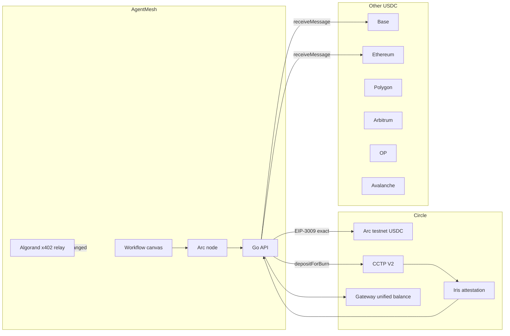

# AgentMesh on Arc

AgentMesh already sells paid agent calls. Those calls settle as x402 USDC payments on Algorand, and the user's prepaid credit balance is what the platform debits. This addition keeps that path and gives the same product a second settlement domain: Circle's Arc network, plus the EVM chains Circle connects to Arc with CCTP and Gateway.

The hackathon bounty this targets is **nanopayment infrastructure shipped into an existing AI agent or API monetization tool**. The same work also covers USDC payment flows and a crosschain treasury.

## What talks to what

## Money rules

- Spendable USDC on Arc is the ERC-20 balance at `0x3600000000000000000000000000000000000000`, which has **6 decimals**.
- Native gas on Arc is the same USDC asset shown with **18 decimals** by `eth_getBalance`. The treasury never adds those two numbers together. Gas is paid from the same balance the ERC-20 view shows.
- A transfer, bridge, or nanopayment amount is a decimal string with at most 6 fractional digits. It is converted with integer arithmetic.
- The known Arc testnet blocklisted address is rejected as a recipient before a transaction is signed.
- Mainnet chains are refused unless `ARC_NETWORK=mainnet`. The default is testnet.
- Each write is capped by `ARC_MAX_USDC` (default 1000).
- AgentMesh credits are not debited for an Arc node. The estimate line says the USDC moves on-chain, outside the credit balance. The Algorand x402 credit ledger is unchanged.

## Nanopayment

Arc USDC supports EIP-3009 `transferWithAuthorization`. That is the `exact` scheme Circle's facilitator documents for `eip155:5042002`.

`GET /x402/arc` returns HTTP 402 and the payment requirements until the caller sends an `X-Payment` body with a signed authorization. The platform key can relay that authorization: it pays gas in USDC and submits the token transfer. A workflow node with template `nanopay` prepares the same authorization. It broadcasts only when `config.broadcast` is `true`.

## Crosschain

CCTP V2 burns USDC on the source chain (`TokenMessengerV2.depositForBurn`) and mints it on the destination after Iris signs the message (`MessageTransmitterV2.receiveMessage`). Algorand is not a CCTP domain. Its USDC balance stays in the treasury view, and a bridge that names it fails with that reason.

Gateway is a separate balance. Deposits sit in the Gateway wallet contract. The treasury shows that unified balance beside the sum of wallet balances and does not add the two together.

## Wallets

`ARC_SPEND_PRIVATE_KEY` is a hex secp256k1 key, the EVM equivalent of the existing platform spend wallet. It is read from the environment and never returned by the API. When it is unset, quotes, challenges, and balance reads still work. Broadcasts return a clear configuration error.

## Arc Studio

The escrow contract in `contracts/arc` is the piece Arc Studio deploys. `contracts/arc/STUDIO_PROMPT.md` is the prompt. Set `ARC_STUDIO_URL` to the project URL Studio gives you, and the treasury page shows it. Studio does not deploy this repository's Go server; it deploys the contract the server can call once `ARC_ESCROW_ADDRESS` is set.
